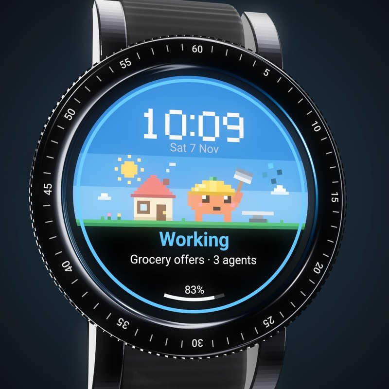
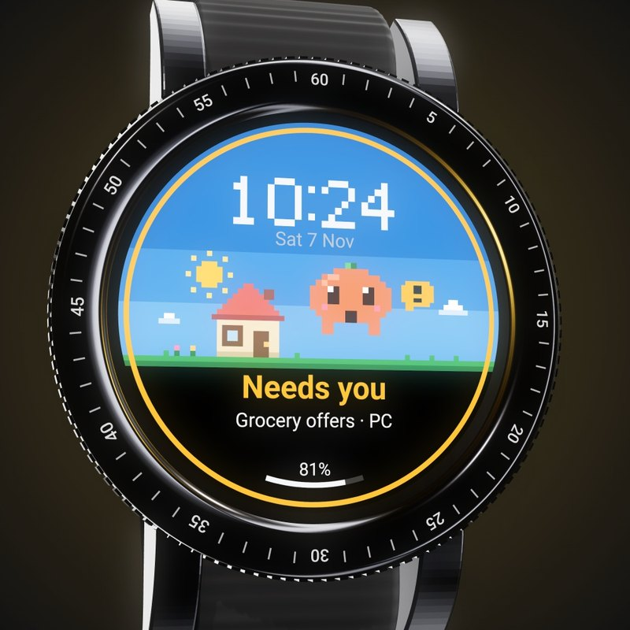
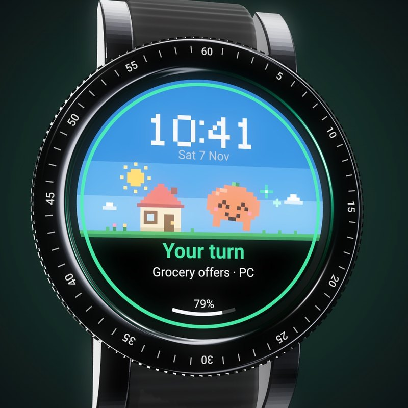
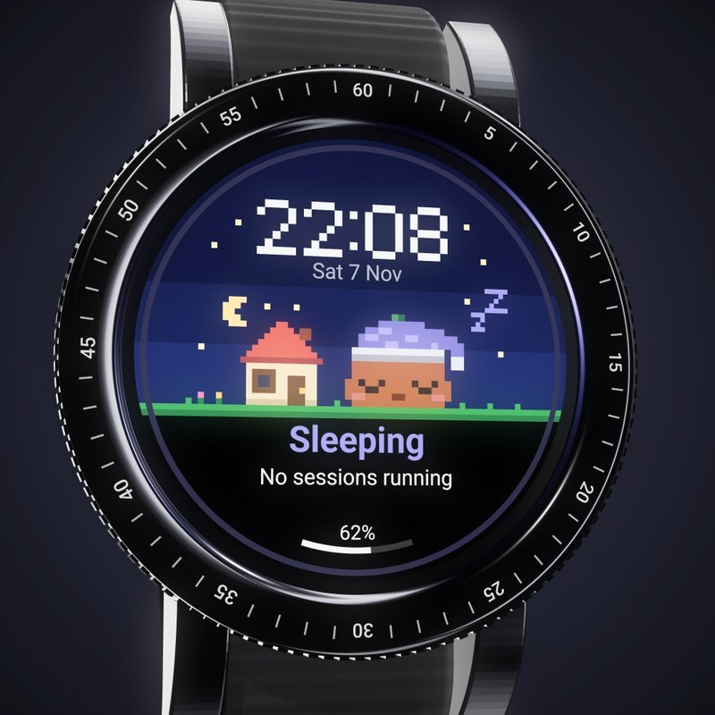
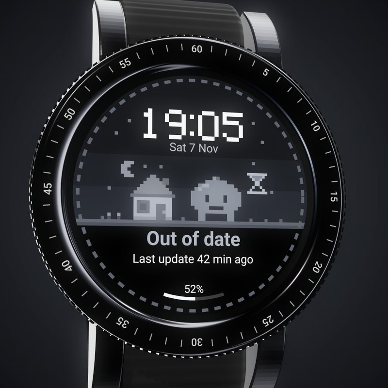

<p align="center">
  <a href="https://mikalio.github.io/claude-watch/"></a>
</p>

<h1 align="center">Claude watch</h1>

<p align="center">
  <b>A little pixel creature on your Galaxy Watch that shows what Claude Code is doing.</b><br>
  <a href="https://mikalio.github.io/claude-watch/">See it running live</a> ·
  <a href="https://mikalio.github.io/claude-watch/#film">Watch the film</a> ·
  <a href="#set-it-up-yourself">Set it up</a>
</p>

You start Claude on something and walk away. Twenty minutes later, you find it's been waiting for you to
press "1". This watch face fixes that: one look at your wrist tells you if Claude is working, needs you, has
handed you the turn, or has nothing to do.

<table>
  <tr>
    <td align="center" width="20%"><br><b>Working</b><br>Hammer, anvil, sparks. It names the session and counts its agents.</td>
    <td align="center" width="20%"><br><b>Needs you</b><br>A permission or a question is waiting. It hops, and wakes a sleeping watch.</td>
    <td align="center" width="20%"><br><b>Your turn</b><br>Claude has finished. It dances for ten minutes.</td>
    <td align="center" width="20%"><br><b>Sleeping</b><br>Nothing running. A sun hat by day, a nightcap by night.</td>
    <td align="center" width="20%"><br><b>Out of date</b><br>No push for 40 minutes while busy. It says so.</td>
  </tr>
</table>

Also on the watch:

- **Sessions:** tap the face for every session, its state, its agents and how long. On a Classic, turn the bezel to scroll.
- **Several at once:** the face counts them ("1 needs you · 2 working").
- **A tile and a complication,** for when you'd rather keep another face.
- **Always-on:** arm down, it dims and keeps still.
- **Few pushes, to save the battery:** only needs you and your turn wake a sleeping watch.

## How it works

```
Claude Code hooks ──► your relay ──► Firebase ──► watch app: face, tile, complication
```

Claude Code's hooks report each session to a small relay you run yourself. The relay works out what the watch
should show and pushes it through Firebase Cloud Messaging. The watch can't answer Claude for you, and it
doesn't buzz: you look at it, and walk back when it asks.

**What leaves your machine:** the state, the folder name of each session, and its agent count go through your own
Firebase project to your watch. Your prompts and code don't.

## Which watches

It's made for the **Samsung Galaxy Watch4, Watch5, Watch6, Watch7 and Watch8**, including the Classic, Pro and Ultra models,
on Wear OS 5 or newer. The screens are round and differ only in size, and the face, tile and Sessions screen are all drawn
for 450 px and scaled to fit.

**What's been tested:** so far it has only run on a Galaxy Watch4 Classic 46 mm. The other models should fit, because everything
scales, but nobody has seen them yet. If something looks off on yours, please [open an issue](https://github.com/Mikalio/claude-watch/issues).

On a Classic, the rotating bezel scrolls the Sessions screen. On the other models, swipe.

### Another kind of watch?

- **Other round Wear OS watches** should be close, for the same reason.
- **Apple Watch, Garmin and others** need a new watch app, but the relay and hooks can stay as they are.

Either way, Claude can do the work. Open this repo in Claude Code and tell it what you have:

> Adapt Claude watch to my Pixel Watch 3. Keep the relay and hooks. Change what this watch needs, and tell me what you couldn't test.

## Set it up yourself

You need Claude Code, somewhere to run a small Docker container, a free Firebase project, and adb to install
on the watch. There's no app store release: the app has to carry your own Firebase config, so you build your own.

### 1. Firebase

1. Create a project in the [Firebase console](https://console.firebase.google.com/).
2. Add an Android app with the package `io.github.mikalio.claudewatch` and download `google-services.json`.
3. In Project settings, Service accounts, generate a new private key. Save it as `firebase-key.json`.
   **It's a secret:** it can send pushes to your watch. Keep it out of Git.
4. Pick a long random topic name, such as `claude-watch-` and 12 random digits. The watch and the relay must use the same one.

### 2. The relay

Run it where your PC can reach it. Keep it off the open internet, or put it behind a tunnel: the hook token is
all that protects it.

```bash
docker build -t claude-watch-relay .
mkdir data && cp firebase-key.json data/   # the container runs as user 99, so user 99 must be able to read this
docker run -d --name claude-watch-relay --restart unless-stopped -p 8079:8000 \
  -v "$PWD/data:/data:ro" \
  -e RELAY_TOKEN=a-long-random-secret \
  -e FCM_TOPIC=your-topic \
  claude-watch-relay
curl http://localhost:8079/health
```

| Setting | Default | What it is |
| --- | --- | --- |
| `RELAY_TOKEN` | required | The secret the hooks send |
| `FCM_TOPIC` | required for pushes | The Firebase topic the watch listens on |
| `FCM_KEY_FILE` | `/data/firebase-key.json` | The service account key |
| `SESSION_TIMEOUT_MIN` | 60 | Silence before a session counts as gone |
| `DONE_FRESH_MIN` | 10 | How long "your turn" shows |
| `KEEPALIVE_MIN` | 15 | Repeat interval while Claude is busy |
| `BATCH_MIN` | 2 | How long smaller changes wait for a push |
| `PUID`, `PGID` | 99, 100 | The user the relay runs as |

Without a Firebase key the relay still runs and logs what it would send, which is a handy first test.

### 3. The hooks

Add the contents of [`hooks.example.json`](hooks.example.json) to `~/.claude/settings.json`, with `YOUR-RELAY` changed to
your relay's address. Then put your token in the environment variable `CLAUDE_WATCH_TOKEN`, and restart Claude Code.
A down relay doesn't hold Claude up: hook failures don't block, and they time out after 3 seconds.

### 4. Build the watch app

Put your topic in `watch/gradle.properties` (`claudeWatchTopic=`), then choose one:

- **On your PC:** with JDK 17, the Android SDK and Gradle 8.11.1, copy `google-services.json` to `watch/app/` and run `gradle assembleDebug` in `watch/`.
- **On GitHub, in a private copy only:** create a private copy of this repo, add the secrets `GOOGLE_SERVICES_JSON` (the
  file's contents) and `FCM_TOPIC`, and run the "Watch app" workflow. The APKs appear under the run's artifacts.

> [!WARNING]
> Don't publish your APK, or put these secrets in a public fork. Your APK holds your Firebase config and topic, so
> anyone with it could read your pushes, including your session names.

### 5. Install it

Turn on wireless debugging on the watch, pair it with `adb`, then:

```bash
adb install -r watch/app/build/outputs/apk/debug/app-debug.apk
adb install -r watch/face/build/outputs/apk/debug/face-debug.apk
adb shell am broadcast -a com.google.android.wearable.app.DEBUG_SURFACE --es operation set-watchface --es watchFaceId io.github.mikalio.claudewatch.face
```

Start a Claude Code session, and the creature wakes up. If the face says "Not connected", hold the face and choose Claude. When
you're done, disconnect adb and turn wireless debugging off, because an attached adb drains the watch fast.

## In this repo

| Part | Where |
| --- | --- |
| Relay and its tests | `relay/`, `tests/`, `Dockerfile` |
| Watch app: tile, complication, Sessions | `watch/app/` |
| Watch face (Watch Face Format, resources only) | `watch/face/` |
| Pixel art and the generated face | `tools/sprites.py`, `tools/face.py`. Change the maps there, not the generated files |
| The landing page | `docs/` |
| The promo film's source (Remotion) | `design/promo/` |

Run the relay's tests with `pip install -r requirements.txt`, then `python -m pytest`.

## Licence

[MIT](LICENSE). The film's music is the exception, see the licence file.

An unofficial side project, not affiliated with Anthropic or Samsung. Claude is a trademark of Anthropic.
